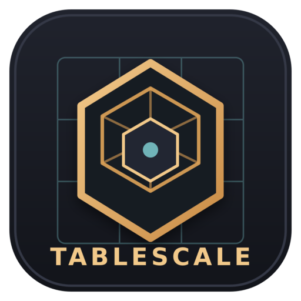

# TableScale

**3D miniature scale converter, STL base generator, and multi-page battle map print tiler.**

TableScale is a fast, native desktop utility for tabletop gamers. It runs
entirely offline and is built with Rust, [`eframe`/`egui`](https://github.com/emilk/egui),
and pure-Rust file, image, PDF, font, and mesh handling.



## Features

### 3D Mini Bases

- Generate parametric, **watertight binary STL** miniature bases for resin or
  FDM printing.
- Circle, pill/oval, and rounded-square profiles with `25`, `32`, `35`, `40`,
  `50`, `65`, and `80 mm` presets plus custom width/depth in millimetres.
- Adjustable height (`3.5 mm` default), bevel width (`1.5 mm` default), bevel
  angle, and an optional recessed top lip with a raised rim.
- Optional underside magnet pocket with `5x2`, `6x2`, and `8x2` presets,
  custom diameter/depth, and a radial fit tolerance (`+0.15 mm` default).
- Underside nameplate using the embedded Ubuntu Light font, so no system font
  is required. Engrave or emboss the text; line or bottom-arc placement is
  chosen automatically to clear the magnet pocket. The text is mirrored so it
  reads correctly when the base is turned over.
- Interactive software 3D preview with orbit/tilt, zoom, pan, solid/wireframe
  modes, and Iso, Top, Bottom, and Front camera presets.
- Export a single `{name}_{size}mm.stl`, or batch-export one STL per line from
  a newline-separated character roster.
- Every mesh is re-validated for closed, manifold edges and outward-facing
  normals before the STL is written. Nameplate letter shapes are unioned and
  triangulated with a constrained Delaunay triangulation to avoid overlapping
  shells.

### Miniature Scaler

- Convert between `28mm`, `32mm`, `35mm`, `54mm`, `75mm`, `1:64`, `1:48`,
  `1:35`, and `1:12` scales, or enter custom millimetres.
- Shows the exact slicer scale percentage with a one-click **Copy %** button
  (`28mm -> 35mm = 125.00%`).
- Calculates 35mm-scale heights from real-world subject heights such as a 6 ft
  human or a 10 ft boss.
- Normalizes an existing printed model's height to 35mm scale.
- Includes a quick base-diameter guide for 25mm, 40mm, 50mm, and 65mm+ bases.

### Battle Map Tiler

- Load PNG, JPG, and WebP battle maps with a file dialog or drag-and-drop.
  Images are decoded in the background, with a 100-megapixel safety limit.
- Define the physical map size by grid count and square size, or by exact
  inches.
- Tile onto **Letter**, **Legal**, or **Tabloid** paper, ISO **A4–A0**, or
  custom paper dimensions in portrait or landscape orientation.
- Margins and glue/tape overlap display in inches or millimetres, switching
  automatically with the paper family. The physical default is `0.25 in` for
  both.
- Paper and printable-area summaries show both millimetres and inches.
- Live page-grid preview with numbered pages, overlap bands, sheet dimensions,
  and effective source DPI.
- Export a true 1:1 multi-page PDF with printer-friendly trim marks, alignment
  guides, and page labels.
- Export clean, numbered 300 DPI PNG tiles with embedded PNG resolution
  metadata and a `PRINTING.txt` assembly manifest.
- Aspect-mismatch protection asks for explicit confirmation before exporting a
  stretched map.
- Page-grid safety limit: 1,000 sheets per export.

Keyboard shortcuts: `Ctrl+1` / `Ctrl+2` switch 2D tabs; `Ctrl+3` opens 3D Mini Bases.

## Build

TableScale requires Rust 1.95 or newer.

### Linux build prerequisites

Install a C toolchain, `pkg-config`, and the X11/Wayland/OpenGL development
packages. On Debian/Ubuntu:

```bash
sudo apt install build-essential pkg-config libx11-dev libxkbcommon-dev \
    libwayland-dev libgl1-mesa-dev libegl1-mesa-dev
```

On Arch Linux:

```bash
sudo pacman -S base-devel pkgconf libx11 libxkbcommon wayland mesa
```

Then build for the host:

```bash
cargo build --release
```

The host binary is written to `target/release/table-scale`. A host build is
linked against the host glibc and is not necessarily portable to older Linux
distributions.

### Portable Linux release build

`scripts/build-linux-portable.sh` uses
[`cargo-zigbuild`](https://github.com/rust-cross/cargo-zigbuild) and Zig to
target glibc 2.35 (Ubuntu 22.04 / Debian 12 baseline). Install Zig 0.14.x and
`cargo-zigbuild` first. Zig can be downloaded from
[ziglang.org](https://ziglang.org/download/) or installed with
`python -m pip install ziglang==0.14.1`:

```bash
cargo install cargo-zigbuild --locked
./scripts/build-linux-portable.sh
```

The resulting `target/release/table-scale` requires glibc 2.35 or newer. Build
a self-contained AppImage with `appimagetool`:

```bash
./scripts/build-appimage.sh
```

The AppImage is written to `dist/TableScale-1.2.0-x86_64.AppImage`. The release
archive includes an `install-linux.sh` helper that installs the binary, icon,
desktop entry, and AppStream metadata under `~/.local` (or `$PREFIX`).

### Windows from Linux

The project uses pure-Rust dependencies and the MSVC target with a static CRT,
so the release `.exe` does not require a separate VC++ Redistributable. It
embeds the application icon and Windows version metadata. Install the MSVC
target and [`cargo-xwin`](https://github.com/rust-cross/cargo-xwin), then:

```bash
rustup target add x86_64-pc-windows-msvc
cargo install cargo-xwin
cargo xwin build --release --target x86_64-pc-windows-msvc
```

The Windows binary is written to:

```text
target/x86_64-pc-windows-msvc/release/table-scale.exe
```

The app uses the OpenGL (`glow`) renderer and needs a working OpenGL
driver (OpenGL 2.1+ or a compatible implementation). Windows VMs and RDP sessions sometimes provide only OpenGL 1.1; if the
window cannot initialize, TableScale now shows a native error dialog. Native
Wayland and X11 are both compiled in; Wayland should be tested on the target
desktop.

## Printing at 1:1

1. Export the PDF or the 300 DPI PNG tiles.
2. In your print dialog choose **100%** or **Actual Size**. Never choose
   **Fit to Page**.
3. For the PDF, trim along the printed cut border. On full sheets this is the
   configured `0.25 in` margin; partial final rows or columns may also have a
   blank remainder to trim away.
4. Assemble the sheets using the numbered pages and the dashed overlap guides.
   Overlap adjacent sheets by the configured amount, usually `0.25 in`.

The PDF already places every tile at its exact physical size and includes the
configured printer margins. PNG tiles are clean, content-only 300 DPI images,
so they need borderless printing or an exact-scale print path that does not
crop the image. The PNG export includes `PRINTING.txt` with page order, sheet
sizes, and overlap instructions. For most printers, the PDF is the more
reliable choice.

## Limits

- Images larger than 100 megapixels are rejected before decoding.
- Layouts requiring more than 1,000 sheets are rejected; increase the square
  size, use larger paper, or reduce margin/overlap.
- Export runs in the background; loading a map is also decoded in the
  background.
- PDF export embeds RGB rasters at up to 300 DPI with lossless printpdf
  compression. Embedded ICC/CMYK color profiles are not preserved; extremely
  large photographic maps may produce large PDFs.

## 3D printing the bases

The base mesh is generated in millimetres with Z up and the underside at
`Z = 0`, ready for a slicer. Engraved nameplates open downward, so print the
base directly on the build plate or add a small tilt and supports if your
resin workflow needs drainage. Embossed nameplates protrude below `Z = 0` and
are included in the reported bounding box. Magnet pockets use the nominal
diameter plus the configured radial tolerance to leave room for glue.

## Scale reference

Nominal ratio scales (`1:64`, `1:48`, `1:35`, `1:12`) use a standard 6 ft
(1828.8 mm) human as their reference height. Miniature scale names such as
`28mm` and `35mm` are treated as the nominal height of that same reference
figure.

## Development

```bash
cargo fmt --check
cargo clippy --all-targets -- -D warnings
cargo test
```

The scale math, millimetre-to-inch conversion, paper geometry, overlap tiling,
page counts, PDF page/media boxes and clip operations, PNG dimensions, DPI
metadata, STL headers/triangle counts, exact millimetre bounding boxes,
edge-manifoldness, magnet and nameplate cavities, letter-shape unions, and
single/batch STL export paths are covered by unit tests.

## Release packaging

`scripts/build-release.sh` runs the quality gates, builds the portable Linux
and Windows binaries, and writes release archives containing the binary,
README, license, third-party notices, and desktop assets to `dist/`.

Code signing, installer creation, and Windows runtime testing are
distribution tasks not automated by the script.

## License

MIT (c) 2026 Prisma Chill. See [LICENSE](LICENSE).
Third-party notices are in [THIRD_PARTY_NOTICES.md](THIRD_PARTY_NOTICES.md).
